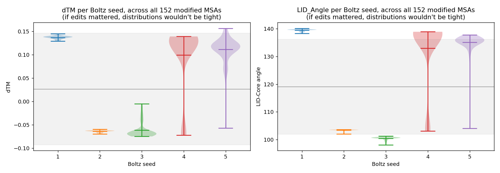
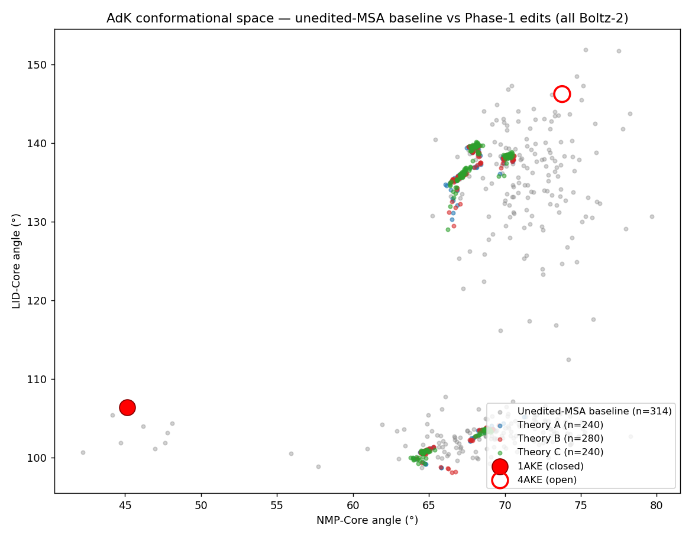

# Steering a structure predictor by editing its MSA — a controlled negative

Can you make a structure predictor choose one conformation over another by editing the
multiple sequence alignment you feed it?

This repository contains the full apparatus built to answer that question for
**adenylate kinase (AdK)**, which exists in a closed (PDB `1AKE`) and an open
(PDB `4AKE`) state: a deterministic MSA-editing engine, a matched null distribution,
a negative-control column, and the analysis that evaluates the result.

**The answer, for this protein and this predictor, is no — and the interesting part is
how cleanly it fails.** The predictor's random seed moves the output about **24× more**
than any of our edits do.



*Each violin holds 152 different edited MSAs run through one Boltz-2 seed. If the edits
were driving the output, every violin would be wide. Seeds 1–3 are needles: the same
structure comes back regardless of which alignment went in.*

---

## The three findings

**1. Seed variance dominates edit variance by 24×.** Decomposing the variance of
`dTM = TM_Open − TM_Closed` over 760 predictions: variance across the 152 edit-recipe
means is `0.00040`, variance across the 5 seed means is `0.00975` — a ratio of
**24.2×** (**39.8×** for the LID-Core angle).

**2. The effects that do exist are direction-blind.** The hypothesis predicts that a
closed-targeted edit and an open-targeted edit push in opposite directions. They don't.
At column 202, dose 100: closed-target `+0.066`, open-target `+0.064`. Under the state
classification below, closed-targeted cells give 31.8% open predictions and
open-targeted cells give 32.4% — statistically the same alignment-editing outcome
regardless of what we aimed at. That is perturbation, not steering.

**3. There is a ceiling we did not put there.** Across all 760 predictions the NMP-Core
angle spans **7.5°**, while the same predictor on the *unedited* MSA spans **37.5°**.
Predictions collapse into two tight clusters and neither touches a reference structure.



**What does survive** is the weaker claim: position of edit matters. The negative-control
column (50, lowest subfamily divergence, no contact change) is null at every dose in both
directions, while columns 136, 202 and 206 produce non-zero — if direction-blind — effects.

---

## Experiments

### Phase 0 — contact-driven ensemble editing (1,296 predictions)

Residue contacts were computed for both conformations with a shadow-map algorithm
(heavy atoms, 5.2 Å cutoff, 1.3 Å shadow radius, |Δseq| ≥ 3), giving 489 contacts in
1AKE and 480 in 4AKE — 423 shared, **66 closed-specific**, **57 open-specific**. The MSA
was then edited at the columns of each contact set under two actions: `promote_joint`
(reinforce the observed pair distribution) and `break` (shuffle identities within a
column, which provably leaves per-column amino-acid composition unchanged and destroys
only the row-to-row pairing). Four ensembles of 324 MSAs each, over a six-parameter grid.

State fractions (classification rule below):

| ensemble | action | closed | intermediate | open |
|---|---|---:|---:|---:|
| A−B | `promote_joint` | 3.7% | 79.6% | 16.7% |
| A−B control | `break` | 0.3% | 63.9% | **35.8%** |
| B−A | `promote_joint` | 4.3% | 73.1% | 22.5% |
| B−A control | `break` | **14.2%** | 69.4% | 16.4% |
| *unedited MSA (null)* | *none* | *3.5%* | *68.5%* | *28.0%* |

Both `promote_joint` ensembles do essentially nothing. Breaking closed-specific contacts
is directional toward open; breaking open-specific contacts is the only ensemble that
populates both endpoints. Because `break` cannot change column composition, any effect
must run through **disruption of co-evolutionary pairing** — verified directly: at the
most-edited column (res 101, 2,367 of 2,651 rows changed) the before/after amino-acid
counts are identical.

The spread-inducing ensemble also makes the *fewest* edits (14,360 vs 22,859) across the
*fewest* columns (17.8 vs 43.1), concentrated on CORE_anchor (residues 90–101, the vertex
of the NMP angle) while leaving the hinge untouched at exactly 0.000 edit fraction.

> **Stated limitation:** every column edited in Phase 0 is by construction a
> contact-active column, so this phase can say nothing about non-contact columns.

### The null distribution and a source-code audit (314 predictions)

The identical unedited MSA was run 314 times. It returns a wide spread (NMP 42–80°),
which initially looked like the model expressing a conformational prior. Reading the
Boltz-2 source showed otherwise: the only data-dependent stochastic operation at
inference is the MSA subsample in `trunkv2.py`
(`torch.randperm(msa.shape[1])[:1024]`). Eval-time dropout is provably inert
(`dropout * training`, with `training=False`), and featurization is hardcoded to seed 42.

So the spread is **random subsampling of 1,024 rows from a depth-2,651 alignment**, not
intrinsic model noise. Every condition here has the same depth, so no condition
accidentally fell below the threshold and became deterministic — the comparison is
matched. See [`docs/subsampling_audit.md`](docs/subsampling_audit.md), which also
documents an upstream CLI flag whose default contradicts its help text.

### Phase 1 — single-column, three mechanisms, dose-response (760 predictions)

Six candidate columns (64, 136, 185, 190, 202, 206) chosen by intersecting Phase-0
empirical signal, Jensen-Shannon divergence between the frustration-selected
Closed500/Open100 subfamilies, and contact reorganization — plus **column 50 as a
negative control**. Three edit mechanisms at each:

- **A — amplification:** resample the column from the target subfamily's distribution.
- **B — break:** shuffle within the column (composition unchanged, pairing destroyed).
- **C — install:** write the target subfamily's modal amino acid into every selected row.

Crossed with two target directions and four doses (25/50/75/100% of editable rows):
152 cells × 5 seeds = **760 predictions**. Results are the three findings above; the
full reading is in [`docs/results.md`](docs/results.md).

---

## How predictions are classified

Every structure yields `TM_Closed` and `TM_Open` (TM-score to 1AKE and 4AKE, iterative
Kabsch superposition over the 214 aligned CA atoms, Zhang-Skolnick normalization
`d0 = 1.24·∛(L−15) − 1.8`) plus two domain hinge angles.

The **leading rule is absolute** — it asks whether a structure actually arrived:

```
closed        if TM_Closed >= 0.85 and TM_Open   < 0.75
open          if TM_Open   >= 0.85 and TM_Closed < 0.75
both          if both >= 0.85                        (ambiguous)
intermediate  otherwise
```

A relative rule (`|TM_Closed − TM_Open| > 0.10`) is also computed in
`analysis/phase0/05_verify_and_export.py`. It reports leaning rather than arrival and
gives systematically higher closed/open fractions; it is reported alongside, never on
its own. All numbers in this README use the absolute rule.

---

## Layout

```
src/
  modifier_v2.py            deterministic single-column MSA editor (library + CLI)
  generate_phase1_sweep.py  builds the 152-MSA sweep and its manifest
  score_boltz.py            CIF parser, TM-score, domain angles (numpy only)
analysis/
  plot_phase1.py            the five Phase-1 figures
  angle_analysis_plot_fixed.py
  check_seed_determinism.sh isolates the source of run-to-run variation
  phase0/01..07_*.py        Phase-0 sweep, MSA diffing, column tendency, audits
results/
  phase0/    per-prediction metrics (1,296), the 314-run null, tendency tables, figures
  phase1/    per-structure metrics (760), per-cell stats with Welch t/p, manifest, figures
  contacts/  shadow-map contact maps and the closed/open delta sets
docs/        results, methods, subsampling audit
data/        checksums + input fetcher (no bulk data in this repo)
notebooks/   Phase-0 editing notebook
```

## Reproducing

```bash
pip install -r requirements.txt
bash data/fetch_inputs.sh          # clones the upstream AdK MSAs, verifies checksums

# regenerate all 152 Phase-1 MSAs (deterministic — no GPU needed)
python src/generate_phase1_sweep.py --out-dir data/outputs_msas
shasum -c data/phase1_msa_checksums.sha256    # must pass 152/152

# re-derive metrics from predicted structures (needs the .cif files, see below)
ADK_STRUCTURES=/path/to/boltz_results python src/score_boltz.py
python analysis/plot_phase1.py
```

The editor is deterministic by construction: seed 0 for row selection, per-row seeds
derived by SHA-256, doses nested so the 25% alignment's substitutions are a literal
subset of the 50%'s. Row 0 (the query) is never edited, gaps are never introduced or
removed, and the 214-column invariant is asserted on every call. `data/phase1_msa_checksums.sha256`
lets anyone confirm they regenerated the exact alignments this analysis used.

**Not distributed here:** the 2,370 predicted `.cif` structures (~380 MB) and the 1,448
generated `.a3m` alignments (~580 MB). The alignments regenerate exactly from the command
above; the structures require GPU inference and are available on request. The upstream
AdK MSAs are fetched rather than vendored, because the source repository carries no
licence.

## Credits

Input alignments and the frustration-based Closed500/Open100 subfamilies come from
Guan et al. (2024), *Predicting protein conformational motions using energetic
frustration analysis and AlphaFold2* — [repository](https://github.com/Gxy-with-luv/AFF2024).
Structure prediction throughout is [Boltz-2](https://github.com/jwohlwend/boltz) v2.2.1.

Work done in the Martí lab, IQUIBICEN (UBA/CONICET), as part of an undergraduate thesis
project. Code is MIT-licensed; see `LICENSE`.
