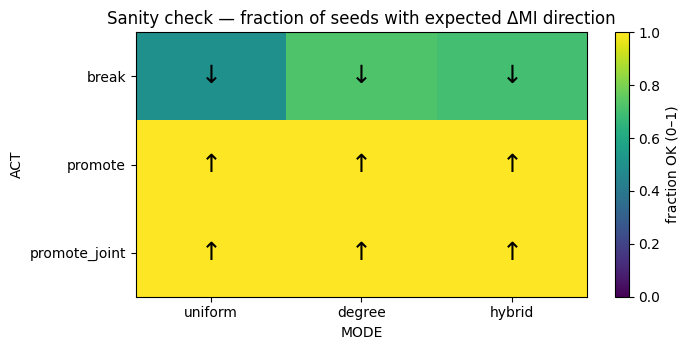
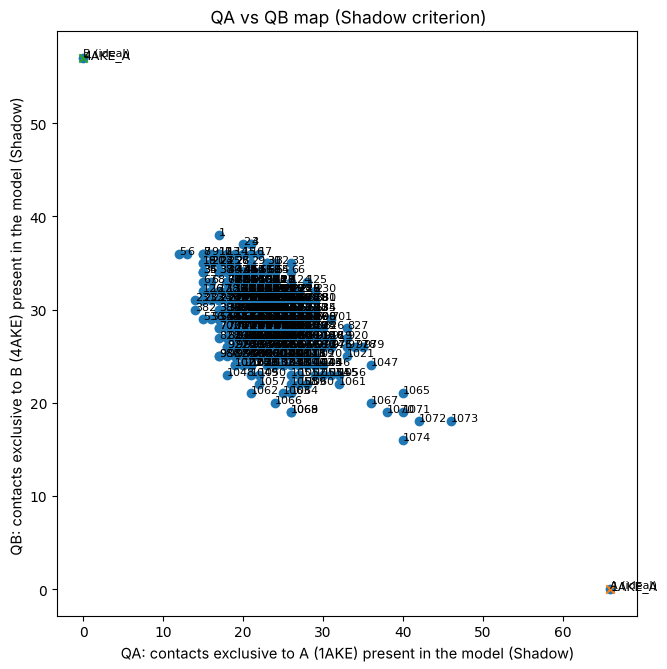
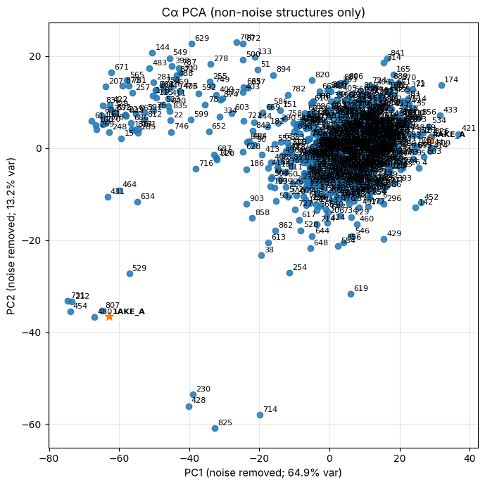
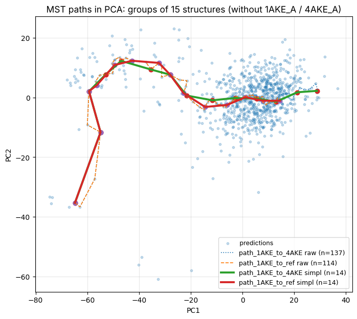

# Exploring the allosteric landscape of adenylate kinase with synthetic MSAs in Boltz

*Generating intermediates between two conformational states from a single query sequence.*

Adenylate kinase (AdK) switches between a closed state (PDB `1AKE`) and an open state
(PDB `4AKE`). A structure predictor such as Boltz-2 reads the evolutionary record of a
protein through its multiple sequence alignment (MSA), and in particular through
**coevolution**: pairs of positions whose residues change together because they are in
contact. The two states of AdK do not share all their contacts. So the question behind
this project is:

> If we impose, or relax, the coevolutionary signal of the contacts that are specific to
> one state, does the predictor move along the path between the two states?

This repository contains the pipeline built to ask that question — compute the contacts
of each crystal, find the ones that change, edit the MSA at exactly those column pairs,
check that the edit did what it should to the coevolution signal, fold every synthetic
MSA with Boltz-2, and map where the predictions land — together with the controls and
corrections added when the work was reviewed.

The pipeline was designed and written by Maia Kaplan as the final project (TP final) of a
bioinformatics course and continued in the Martí lab (IQUIBICEN, UBA/CONICET). The
step numbers below follow the original presentation.

---

## The pipeline

```
 1AKE ─┐                                          ┌─► 5.1 QA / QB contact map
       ├─► 1 contacts ─► 2 Δcontacts ─┐           │
 4AKE ─┘                              ├─► 3 edit ─► 4 sweep ─► Boltz-2 ─┼─► 5.2 PCA (+ paths)
 MSA.a3m (2,651 seqs) ────────────────┘   │                      │
                                          └─► 3.3–3.4 MI check   └─► TM-score / hinge angles
                                                                      vs. a 314-run null
```

| step | what it does | code |
|---|---|---|
| 0 | download the two crystals, keep chain A protein atoms | `pipeline/00_get_crystals.py` |
| 1 | residue contacts with the **Shadow** criterion | `pipeline/01_contacts_shadow.py` |
| 2 | **Δcontacts**: contacts lost, gained and conserved between the states | `pipeline/02_delta_contacts.py` |
| 3 | the **MSA editor**: actions, pair-selection modes, MI per pair | `pipeline/msa_editor.py` |
| 3.3–3.4 | MI sanity check on a synthetic alignment | `pipeline/03_sanity_check_mi.py` |
| 4 | the **sweep** of synthetic AdK alignments | `pipeline/04_generate_sweep.py` |
| 5 | fold with Boltz-2 (external, GPU) | see [Reproducing](#reproducing) |
| 5.1 | **QA vs QB**: how many state-specific contacts each prediction recovers | `pipeline/05a_qa_qb.py` |
| 5.2 | **PCA** of Cα coordinates and **paths** through the PCA plane | `pipeline/05b_pca.py`, `pipeline/05c_pca_paths.py` |

The original notebook is kept as it was presented: [`notebooks/TP_final_demo.ipynb`](notebooks/TP_final_demo.ipynb).
The scripts are that notebook's cells moved into files, with command-line paths instead of
Colab paths. Full method details are in [`docs/pipeline.md`](docs/pipeline.md).

### 1–2 · Contacts and Δcontacts

Heavy-atom contacts within 5.2 Å, discarded when another atom sits within 1.3 Å of the
line joining them (the "shadow"), with at least 3 residues of sequence separation.

| | 1AKE (closed) | 4AKE (open) |
|---|---:|---:|
| contacts | 489 | 480 |
| shared | 423 | 423 |
| **specific to the state** | **66** (A−B, "lost") | **57** (B−A, "gained") |

Residues that gain the most contacts on opening include Leu67, Ile101, Leu168 and Ile65;
those that lose the most include Leu58, Arg36, Leu35 and Arg167
(`results/contacts/`).

### 3 · Editing the MSA

The editor takes the original MSA and a list of contact pairs (residues *i*, *j* →
MSA columns A, B) and changes the residues in a fraction of the rows:

| action | what happens in the selected rows | expected effect on coevolution |
|---|---|---|
| `promote` | B is resampled from P(B \| A = a): B is made to "agree" with A | MI up |
| `promote_joint` | A and B are resampled together from the joint P(A, B) | MI up |
| `break` | the residues of B are shuffled among the rows | MI down — **negative control**: the column keeps its amino-acid composition, only the pairing is destroyed |

Which pairs get edited is decided by the **mode**: `uniform` (all pairs equal),
`degree` (favours residues involved in many contacts), `dist` (favours closer contacts) or
`hybrid` (both). The remaining knobs are `frac` (fraction of pairs edited), `strength`
(fraction of valid rows edited per pair), `seed`, `alpha` (pseudocount) and `gamma`
(an exponent that sharpens the distribution before sampling).

**3.3–3.4 · Does the edit do what it says?** Coevolution is measured as the mutual
information (MI) of each edited pair before and after. On a synthetic alignment with one
planted coupled pair, `promote` and `promote_joint` raise MI in 100% of 40 seeds in all three
modes tested, and `break` lowers it in 50–73% of seeds:



### 4 · The sweep

Two grids were run, both in `degree` mode, seeds 11/22/33, alpha 0.05/0.1,
gamma 2/3/4, minimum sequence separation 8/12:

| sweep | contact sets | actions | frac × strength | alignments |
|---|---|---|---|---:|
| presentation (TP) | one Δcontact set | `promote`, `promote_joint` | 0.2–0.8 × 0.4–0.8 | 864 |
| ensembles | A−B and B−A | `promote_joint`, `break` | 0.3–0.9 × 0.3–0.9 | 4 × 324 = 1,296 |

The editor is deterministic: `pipeline/04_generate_sweep.py` regenerates all 1,296
ensemble alignments **byte for byte** (checked against `data/sweep_msa_checksums.sha256`).

---

## What came out

Editing the MSA did not steer Boltz-2 toward a chosen state.

### 5.1–5.2 · Where the predictions land (presentation sweep + 210 exploratory runs: 1,074 Boltz-2 predictions)



**QA vs QB.** Each prediction is placed by how many of the 66 closed-specific (QA) and the
57 open-specific (QB) contacts it contains. The crystals sit at the two corners
(1AKE at 66, 0; 4AKE at 0, 57). The predictions form one cloud between them, closer to
the open side: median 22 closed-specific and 29 open-specific contacts. 77 of the 1,074
lean closed (QA > QB), and the best recovers 46 of the 66 closed-specific contacts.



**PCA.** After superposing every structure on 4AKE (Cα, Kabsch), the first PCA
(1,077 structures) separates a distinct cluster of 171 structures far along PC1, which was
set aside as noise; repeating the PCA on the remaining 906 gives PC1 = 64.9% and
PC2 = 13.2% of the variance. Most predictions form a dense cloud around 4AKE; 1AKE sits at
the far end of PC1 with a handful of predictions near it. A minimum-spanning-tree path
over a k-nearest-neighbour graph connects the prediction closest to 1AKE with the one
closest to 4AKE, and is simplified to 14 representative structures — candidate
intermediates between the two states:



### Ensembles: imposing vs. relaxing coevolution (1,296 predictions)

The four ensembles were folded once each with Boltz-2 and scored by TM-score against
1AKE and 4AKE. A prediction counts as **closed** or **open** only if it actually reaches
that state (TM ≥ 0.85 to it and < 0.75 to the other; see
[`docs/evaluation.md`](docs/evaluation.md)). The reference is the **unedited MSA run
314 times**, because Boltz-2 randomly subsamples 1,024 of the 2,651 sequences on every
run, so even an unedited alignment gives a spread of structures
([`docs/subsampling_audit.md`](docs/subsampling_audit.md)).

| ensemble | contacts edited | action | closed | intermediate | open |
|---|---|---|---:|---:|---:|
| *unedited MSA (null)* | — | — | *3.5%* | *68.5%* | *28.0%* |
| A−B | closed-specific | `promote_joint` | 3.7% | 79.6% | 16.7% |
| B−A | open-specific | `promote_joint` | 4.3% | 73.1% | 22.5% |
| A−B control | closed-specific | `break` | **0.3%** | 63.9% | **35.8%** |
| B−A control | open-specific | `break` | **14.2%** | 69.4% | **16.4%** |

**Relaxing coevolution shifted the state fractions; imposing it did not.** Compared with
the unedited null, breaking the closed-specific contacts left almost no closed
predictions (0.3% vs 3.5%), and breaking the open-specific contacts raised them to 14.2%.
Because `break` keeps each column's composition, any such effect would have to run
through the pairing of residues. This is an exploratory observation, not a demonstrated
effect: each alignment was folded once, on one protein, and the shift does not grow with
edit strength.

**Imposing coevolution with `promote_joint` did not move it.** Both `promote_joint`
ensembles stay close to the null. The MI check on the real AdK alignment explains part of
this (next section): at medium and high strength `promote_joint` did not raise MI at all.

### Checking the MI on the real alignment

The toy check above uses an alignment with one planted, diverse coupling. Running the
same check on every alignment of the real ensembles
(`evaluation/mi_on_real_msa.py`, `results/sanity_check/mi_on_real_msa.csv`):

| action | strength 0.3 | strength 0.6 | strength 0.9 |
|---|---:|---:|---:|
| `break` — share of alignments where MI went down | 100% | 100% | 100% |
| `promote_joint` — share where MI went up | 81–85% | 22–58% | 4–6% |

`break` behaves exactly as designed. `promote_joint` with a sharpened joint distribution
pushes most edited rows onto the single most common residue pair. In a typical
strength-0.9 alignment (A−B, frac 0.9, gamma 3) the edited columns drop from 1.45 to
0.60 bits of entropy, and the most common residue goes from 65% to 85% of the rows. A column with little variation carries little mutual
information, so at high strength `promote_joint` imposes *conservation* rather than
*coevolution*. That is a property of the real alignment that the toy alignment could not
show, and it is the main thing to change in the next version of the sweep (lower
strength or gamma for `promote_joint`; see [`docs/review_notes.md`](docs/review_notes.md)).

---

## Review notes

The pipeline was reviewed with Claude (Anthropic) in 2026. Everything that was found is
written up in [`docs/review_notes.md`](docs/review_notes.md); the main points:

1. **Shared columns are overwritten in order.** All selected pairs edit the same columns
   one after another, so a column in several selected pairs keeps the last pair's edit.
   The original behaviour stays the default (it is what was folded); `--overlap lock`
   is an opt-in fix.
2. **`promote_joint` lowers MI at high strength** on the real alignment (above).
3. **`gamma` is a real knob** that sharpens the distribution before sampling, and MI is
   raw (no finite-sample or APC correction) — fine as a before/after check, not
   comparable to published MI values.
4. **Everything was folded with Boltz-2**, not AlphaFold2, and the spread of repeated
   runs comes from Boltz-2's random MSA subsampling; the 314-run unedited null and the
   TM-score classification were added to evaluate the ensembles.
5. **1AKE is solved with the Ap5A ligand**; contacts are protein-only, so ligand-mediated
   LID closure is invisible to steps 1–2.

## Follow-up: single-column edits

A later experiment (`followup/`) asked whether editing **one** column at a time, with
three mechanisms and four doses, could steer Boltz-2 reproducibly. It could not: across
760 predictions the random seed moved the output about 24 times more than the edits did,
and the effects that existed did not depend on which state was targeted. Design, results
and figures: [`docs/followup_phase1.md`](docs/followup_phase1.md).

---

## Layout

```
pipeline/            the pipeline, steps 0–5 (msa_editor.py is the editor library)
notebooks/           TP_final_demo.ipynb, the original notebook
evaluation/          scoring of the ensembles, MI check on the real MSA, subsampling check
  sweep/             01–07: merge predictions, MSA diffs, per-column tendency, figures, audits
followup/            single-column dose-response experiment (modifier_v2.py and results/)
results/
  contacts/          Shadow contacts of 1AKE and 4AKE, Δcontacts, top gainers/losers
  sanity_check/      MI check figures (toy) and mi_on_real_msa.csv
  structures/        QA vs QB map
  pca/               PCA, PCA without noise, paths
  sweep_evaluation/  per-prediction metrics of the 1,296 ensemble predictions, the 314-run null
docs/                pipeline, evaluation, review notes, subsampling audit, follow-up
data/                input fetcher and checksums (no bulk data in this repo)
```

## Reproducing

```bash
pip install -r requirements.txt
bash data/fetch_inputs.sh                       # Guan et al. AdK alignments, checksum-verified

# steps 0–2: crystals, contacts, Δcontacts (outputs already in results/contacts/)
python pipeline/00_get_crystals.py --out-dir pdb
python pipeline/01_contacts_shadow.py --pdb pdb/1AKE_chainA_protein_only.pdb \
       --out-contacts 1AKE_residue_contacts_shadow.csv --out-matrix contact_matrix_1AKE_chainA_shadow.csv
python pipeline/02_delta_contacts.py --csv-a 1AKE_residue_contacts_shadow.csv \
       --csv-b 4AKE_residue_contacts_shadow.csv --out-dir my_contacts

# step 3.4: MI sanity check on the synthetic alignment
python pipeline/03_sanity_check_mi.py

# step 4: regenerate the 1,296 ensemble alignments and verify them
python pipeline/04_generate_sweep.py --msa data/AFF2024/AdK/Frustration-Energy-space/MSA.a3m \
       --ensemble all --out-root data/sweep_msas
(cd data/sweep_msas && shasum -a 256 -c ../sweep_msa_checksums.sha256)

# step 5: fold each alignment with Boltz-2 v2.2.1 (GPU), MSA subsampling on (1,024 rows)
# step 5.1–5.2 on a folder of predicted structures plus 1AKE_A.pdb and 4AKE_A.pdb
python pipeline/05a_qa_qb.py   --structures-dir all_structures --results-dir out_qaqb
python pipeline/05b_pca.py     --structures-dir all_structures --results-dir out_pca
python pipeline/05c_pca_paths.py --pca-csv out_pca/pca_projection_kabsch_NO_RUIDO.csv \
       --map-csv out_pca/pca_label_map_NO_RUIDO.csv --out-dir out_paths
```

**Not distributed here:** the predicted `.cif` structures (GPU output) and the generated
alignments (they regenerate exactly from the commands above). The upstream AdK
alignments are fetched rather than copied, because the source repository carries no
licence.

## Credits

Pipeline, contact analysis, MSA editor, sweeps and structure analysis: **Maia Kaplan**,
Martí lab, IQUIBICEN (UBA/CONICET). Review, ensemble scoring, the subsampling audit and the
single-column follow-up were done with Claude (Anthropic).

Input alignments come from Guan et al. (2024), *Predicting protein conformational motions
using energetic frustration analysis and AlphaFold2* —
[repository](https://github.com/Gxy-with-luv/AFF2024). Structure prediction:
[Boltz-2](https://github.com/jwohlwend/boltz) v2.2.1. Code is MIT-licensed; see `LICENSE`.
